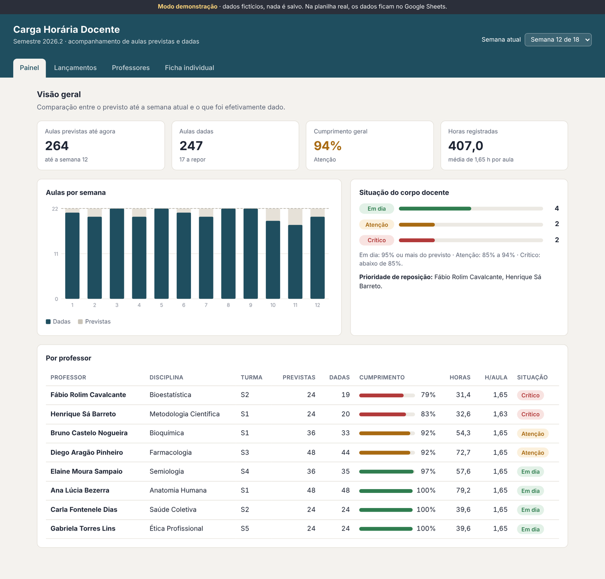
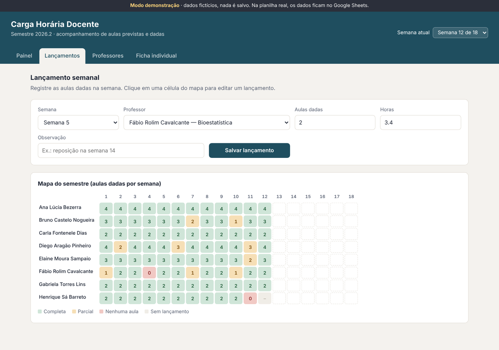
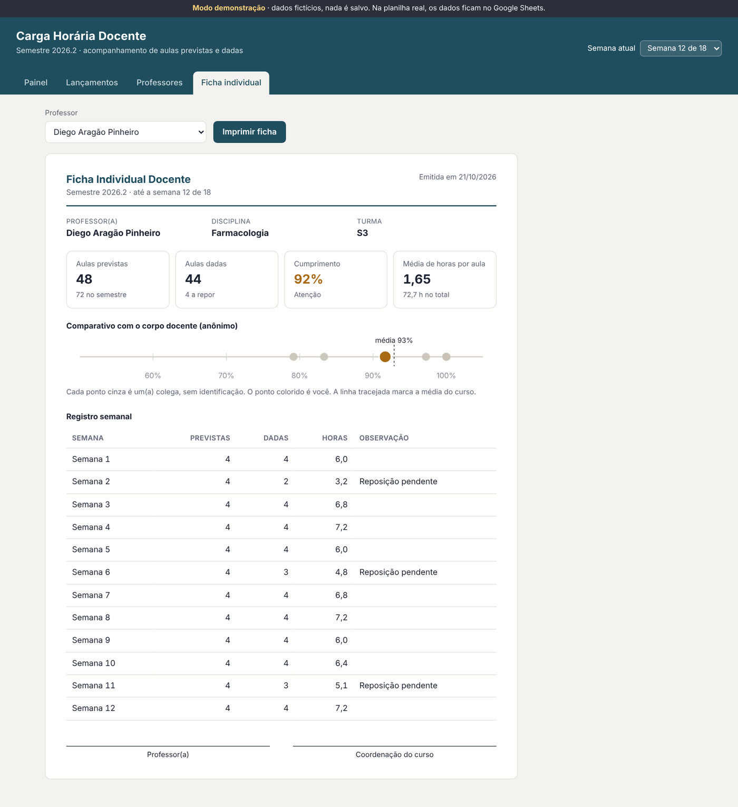

# 🗓️ Sistema de Carga Horária Docente

**Substitui um conjunto de planilhas Excel por um sistema web simples, feito em Google Apps Script com o Google Sheets como banco de dados, para a coordenação acompanhar aulas previstas e dadas e imprimir a ficha individual de cada professor.**

### ▶️ [Abrir a demonstração](https://jjlosmak.github.io/sistema-carga-horaria/)
Roda direto no navegador, com dados fictícios. Nada é salvo.

---

## O problema

A coordenação acompanhava a carga horária dos professores em **várias planilhas Excel**, uma por turma, cada uma com suas abas de dashboard, registro semanal, parâmetros e ficha individual. Isso trazia problemas recorrentes:

- **Retrabalho:** qualquer ajuste no modelo precisava ser replicado à mão em cada planilha.
- **Versões do Excel:** fórmulas e gráficos se comportavam diferente de um computador para outro.
- **Visão fragmentada:** para saber quem estava atrasado era preciso abrir arquivo por arquivo.

Primeiro padronizei as planilhas num modelo único, aprovado pela supervisão e replicado para as demais turmas. Depois, o passo seguinte foi este sistema.

## A solução

Um app web que mora dentro de uma planilha do Google:

- 📊 **Painel:** previsto x dado até a semana atual, cumprimento geral, horas registradas, gráfico semanal e a situação de cada professor (*Em dia*, *Atenção*, *Crítico*), já ordenada por quem precisa de reposição.
- ✍️ **Lançamento semanal:** um formulário que já vem preenchido com a carga prevista, mais um **mapa do semestre** em que cada célula é uma semana. Basta clicar para corrigir.
- 👩‍🏫 **Cadastro de professores** com a carga semanal prevista.
- 🖨️ **Ficha individual pronta para imprimir:** só os dados do professor, com um **comparativo anônimo** em relação aos colegas (ele vê onde está, mas não quem são os outros) e espaço para assinaturas.

| Lançamentos | Ficha individual |
|---|---|
|  |  |

Veja também a [ficha como sai na impressão (PDF)](docs/ficha-exemplo.pdf).

## Decisões de projeto

- **Google Sheets como banco:** a instituição já usa Google Workspace. Não precisa de servidor, hospedagem nem custo, e a coordenação continua podendo abrir os dados como planilha.
- **Uso só pela coordenação, sem login do professor:** foi uma escolha deliberada. O professor recebe a ficha impressa, o que mantém o sistema simples e evita expor dados de colegas.
- **Comparativo anônimo:** o professor entende seu desempenho em relação ao grupo sem que ninguém seja identificado.
- **Gravação segura:** `LockService` impede que dois lançamentos simultâneos se sobrescrevam, e o servidor valida semana, professor e valores antes de gravar.
- **Um único arquivo de interface:** o mesmo `Index.html` roda no Apps Script (via `google.script.run`) e no navegador em modo demonstração.

## Como instalar numa planilha

1. Crie uma planilha nova no Google Sheets.
2. Vá em **Extensões → Apps Script**.
3. Copie o conteúdo de [`apps-script/Code.gs`](apps-script/Code.gs) e crie um arquivo HTML chamado `Index` com o conteúdo de [`apps-script/Index.html`](apps-script/Index.html).
4. Rode a função **`configurarPlanilha`** uma vez. Ela cria as abas `Parametros`, `Professores` e `Lancamentos` com dados de exemplo.
5. Clique em **Implantar → Nova implantação → App da Web** e abra o link gerado.

Estrutura das abas:

| Aba | Colunas |
|---|---|
| `Parametros` | `semestre`, `semanas`, `semanaAtual`, `horasPorAula` |
| `Professores` | `id`, `nome`, `disciplina`, `turma`, `aulasPorSemana`, `ativo` |
| `Lancamentos` | `semana`, `professorId`, `aulasDadas`, `horas`, `observacao`, `atualizadoEm` |

## Contexto

A primeira versão deste sistema foi criada para a coordenação de um curso de uma instituição de ensino superior. Esta versão pública usa **dados fictícios**: os professores e disciplinas citados não existem.

---

Feito por [Jerônimo](https://github.com/jjlosmak) · automação de processos e IA aplicada
